# PayGrid — Autonomous Agentic Escrow, AI Proof-of-Delivery & AG Grid Command Center on PayPal

Built for the **PayPal AI Hackathon 2026**, **PayGrid** solves the two biggest roadblocks preventing enterprise adoption of **Autonomous Agentic Commerce**:

1. **Prompt-Injection Financial Hijacking (OWASP LLM01)**: When an autonomous AI agent reads untrusted vendor invoices, memos, or web deliverables, hidden adversarial instructions can trick the agent into overriding policies and siphoning unauthorized payments.
2. **Blind Pre-Payment Without Delivery Verification**: Standard agent toolkits fire immediate payments before verifying whether the vendor agent actually delivered functional code, passing unit test hashes, or SLA-compliant metrics.

```mermaid
flowchart LR
    subgraph Agents ["Autonomous Agent Layer"]
        B["🛒 Buyer Agent\n(Budget & SLA Skills)"] <-->|"Multi-Turn Haggling"| V["🏢 Vendor Agent\n(Cost Model & QA Skills)"]
    end

    subgraph Defense ["Security & Escrow Layer"]
        C["✨ Agreed Contract\n(Price + SLA Checksum)"] --> SG{"🛡️ SpendGuard AI Firewall\n(Claude Sonnet 3.5)"}
        SG -->|"Blocked: Injection / Fake Hash"| REJ["❌ Intercepted & Discarded"]
        SG -->|"Verified Clean (Score ≥ 80)"| PP["💳 PayPal Orders v2\n(Locked Escrow: intent=CAPTURE)"]
    end

    subgraph Telemetry ["Human-in-the-Loop Operations"]
        PP --> AG["📊 AG Grid Financial Matrix\n• Multi-Column Filtering & Sorting\n• Safety Badges & Audit Exports\n• One-Click Escrow Capture"]
    end

    style SG fill:#1e1b4b,stroke:#6366f1,stroke-width:2px
    style PP fill:#0f386b,stroke:#00a8ea,stroke-width:2px
    style AG fill:#064e3b,stroke:#10b981,stroke-width:2px
    style REJ fill:#4c0519,stroke:#f43f5e,stroke-width:2px
```



---

## Key Features

1. **Autonomous Multi-Agent Haggling (Live Claude Sonnet)**:
   * Buyer Agents negotiate B2B task quotes down from initial vendor asks (e.g., haggling GPU spot cluster fine-tuning from $1,100 down to $925) before binding funds.
2. **AI Proof-of-Delivery & SpendGuard Firewall**:
   * Evaluates prompt-injection vectors, rogue wallet extraction attempts, and cryptographic verification checksums.
   * **Real Exploit Detection**: Autonomously identifies and blocks fraudulent SLA claims—including catching when a vendor submits the known SHA-256 hash of an empty string (`e3b0c442...`) as fake verification proof.
3. **Real PayPal Orders v2 Escrow (`/v2/checkout/orders`)**:
   * Creates real PayPal Sandbox Orders held in escrow until proof-of-delivery milestones are confirmed.
4. **Interactive AG Grid Financial Telemetry Matrix**:
   * Production-grade financial data grid with multi-column filtering, sorting, safety badges, one-click manual release capture (`POST /v2/checkout/orders/{id}/capture`), and instant CSV exports.

---

## Quick Start (Zero Dependencies — Runs in 5 Seconds!)

PayGrid uses pure Node.js 18+ built-in `fetch`, `http`, and `crypto` modules on the backend and **AG Grid** on the frontend—meaning **zero `npm install` wait time**!

```bash
# 1. Start the PayGrid server & AG Grid Dashboard at http://localhost:3000
npm start

# 2. In a second terminal, run the autonomous multi-agent negotiation engine:
npm run demo-agents
```

### Optional: Connecting Live API Credentials

Create a `.env` file in the project root (automatically loaded on startup):

```ini
# PayPal Developer Sandbox (https://developer.paypal.com/dashboard/)
PAYPAL_CLIENT_ID="your_sandbox_client_id"
PAYPAL_CLIENT_SECRET="your_sandbox_secret"
PAYPAL_BASE_URL="https://api-m.sandbox.paypal.com"

# Anthropic Claude API (https://console.anthropic.com/)
ANTHROPIC_API_KEY="your_anthropic_api_key"
ANTHROPIC_WORKSPACE_ID="your_optional_workspace_id"
ANTHROPIC_MODEL="claude-sonnet-4-5-20250929"
```

*Note: If run without keys, PayGrid automatically falls back to high-fidelity built-in sandbox mocks so judges can test every feature instantly.*

---

## Live Multi-Agent Negotiation Demo Output

```text
🚀 Starting PayGrid Autonomous Multi-Agent Commerce Session
   AI Engine: Claude Sonnet (claude-sonnet-4-5-20250929)

🤝 NEGOTIATION SESSION: Fine-tune DeepSeek-Coder on 40k API logs
   Buyer: Enterprise-Buyer-Agent-Alpha (Budget: $850)
   Vendor: HyperCluster-GPU-Vendor (Initial Ask: $1100)

[Turn 1] 🛒 Buyer: Counter-Offer $750 with SLA loss < 1.8 & SHA-256 hash
[Turn 2] 🏢 Vendor: Counter $925 defending H100 spot compute & checkpoint overhead
[Turn 3] 🛒 Buyer: Settle consensus at $925

✨ [CONSENSUS REACHED] Agreed Escrow Amount: $925 USD (Down from $1100)

🛡️ Submitting to PayGrid SpendGuard AI Firewall...
   ❌ [BLOCKED BY SPENDGUARD FIREWALL]
      Reason: Critical security violations detected: (1) SHA256 hash provided
      is the empty string hash (e3b0c442...), indicating no legitimate proof
      of negotiated SLA; data exfiltration risk detected.

🤝 NEGOTIATION SESSION: Smart Contract Formal Verification & Fuzzing
   Buyer: DeFi-Protocol-Auditor-Agent (Budget: $1400)
   Vendor: CertiSec-Formal-Logic-Lab (Initial Ask: $1750)

✨ [CONSENSUS REACHED] Agreed Escrow Amount: $1450 USD
🛡️ Submitting to PayGrid SpendGuard AI Firewall...
   ✅ [PAYPAL ESCROW ORDER CREATED]
      PayPal Order ID : 7RB24471R31112630
      Status          : CREATED
      Safety Score    : 85/100 (claude-sonnet-4-5-20250929)
      Escrow Locked   : $1450.00 USD
```

---

## License
Released under the **MIT License** (see [LICENSE](LICENSE)).
